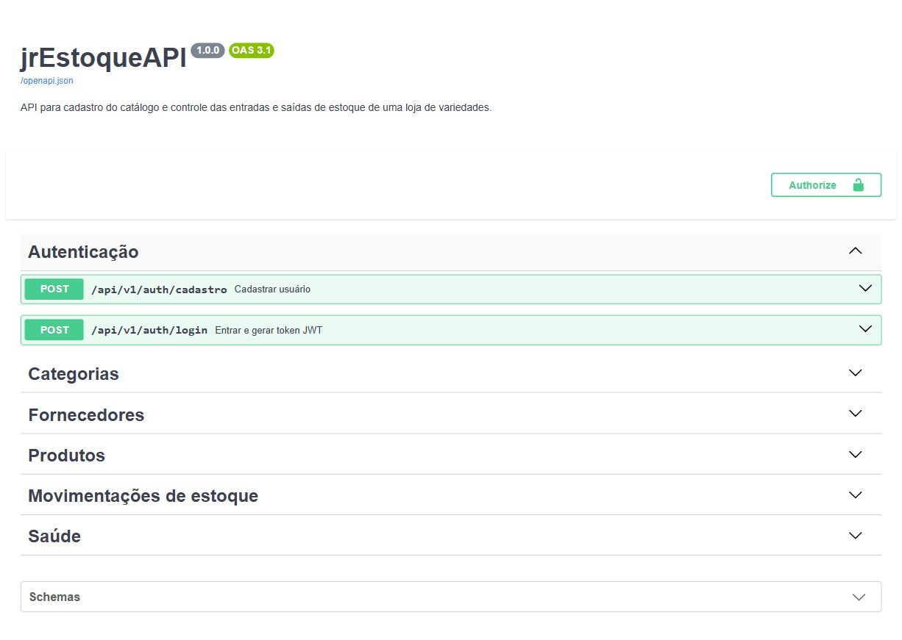

# jrEstoqueAPI

API REST para controlar o estoque de uma loja de variedades. Nela é possível cadastrar categorias,
fornecedores e produtos, além de registrar entradas e saídas de estoque.

O projeto foi desenvolvido para o desafio de Back-end da Ecomp Jr. 2026.2. Além dos requisitos
principais, implementei autenticação com JWT, testes automatizados e controle de concorrência nas
movimentações.

## Funcionalidades

- cadastro, consulta, atualização e exclusão de categorias, fornecedores e produtos;
- registro de entradas e saídas com atualização automática do saldo;
- histórico de movimentações sem edição ou exclusão;
- busca de produtos por nome, categoria e fornecedor;
- consulta de produtos com estoque baixo;
- filtros de movimentações por período, produto, fornecedor e tipo;
- autenticação para as operações que alteram dados;
- respostas de erro padronizadas;
- logs de autenticação, movimentações e erros inesperados;
- documentação interativa com Swagger.

## Tecnologias

- Python 3.12 e FastAPI;
- PostgreSQL, SQLAlchemy e Alembic;
- Pydantic;
- JWT e Argon2;
- Pytest e HTTPX;
- Docker e Docker Compose;
- Ruff e GitHub Actions.

## Como executar

É necessário ter Docker e Docker Compose instalados.

Primeiro, copie o arquivo de variáveis de ambiente:

```bash
cp .env.example .env
```

No PowerShell, use:

```powershell
Copy-Item .env.example .env
```

Depois, suba a API e o banco:

```bash
docker compose up --build
```

As migrations são aplicadas automaticamente antes de a API iniciar. Quando o terminal indicar que
o servidor está disponível, abra a documentação no navegador:

```text
http://localhost:8000/docs
```

Também há um endpoint simples para verificar se a aplicação está respondendo:

```bash
curl http://localhost:8000/health
```

Resposta esperada:

```json
{
  "status": "ok"
}
```

Para encerrar os containers:

```bash
docker compose down
```

## Documentação da API

O Swagger mostra os campos obrigatórios, exemplos de requisição, filtros e respostas de cada
endpoint. Ele também permite testar as rotas pelo navegador.



As rotas estão divididas em:

- `/api/v1/auth`: cadastro e login;
- `/api/v1/categorias`: gerenciamento das categorias;
- `/api/v1/fornecedores`: gerenciamento dos fornecedores;
- `/api/v1/produtos`: catálogo, filtros e consulta de estoque baixo;
- `/api/v1/movimentacoes`: entradas, saídas e consulta do histórico;
- `/health`: verificação da aplicação.

## Autenticação

As consultas são públicas. Para criar, atualizar ou excluir dados, é necessário possuir um token.

O usuário pode ser criado em `POST /api/v1/auth/cadastro`. Depois, o login é feito em
`POST /api/v1/auth/login`, informando o e-mail no campo `username` e a senha no campo `password`.

No Swagger, o botão **Authorize** faz esse processo. Em outros clientes, o token deve ser enviado
no cabeçalho:

```text
Authorization: Bearer SEU_TOKEN
```

As senhas não são armazenadas diretamente. Antes de chegar ao banco, elas passam pelo Argon2.

## Logs

A aplicação usa o módulo `logging` do Python com data, nível, módulo e evento. São registrados os
cadastros e logins de usuários, as movimentações, as tentativas de saída sem saldo e os erros
inesperados. Senhas e tokens não são incluídos nos logs.

## Regras principais

- Produtos são criados com saldo zero.
- O saldo só muda por meio de uma movimentação.
- Entradas aumentam o saldo e saídas diminuem.
- Uma saída maior que o saldo disponível é recusada.
- Movimentações não podem ser alteradas ou excluídas.
- Produtos que já possuem movimentações não podem ser excluídos.
- Categorias e fornecedores em uso também não podem ser excluídos.
- SKU, CNPJ e os campos definidos como únicos não podem ser repetidos.

O saldo e a movimentação são salvos na mesma transação. Durante esse processo, o produto é
consultado com `SELECT ... FOR UPDATE`, evitando que duas saídas simultâneas utilizem o mesmo saldo.

## Organização

```text
ecomp-stock-api/
├── alembic/           # migrations do banco
├── app/
│   ├── api/           # rotas e dependências
│   ├── core/          # configurações, segurança e exceções
│   ├── db/            # conexão com o banco
│   ├── models/        # tabelas do SQLAlchemy
│   ├── schemas/       # validação dos dados
│   ├── services/      # regras de negócio
│   └── main.py        # criação da aplicação
├── docs/              # imagens usadas na documentação
├── tests/             # testes automatizados
├── docker-compose.yml
├── Dockerfile
└── pyproject.toml
```

De forma resumida, a rota recebe a requisição, o schema valida os dados e o service executa a regra
de negócio usando os models.

## Testes

Para executar os testes fora do Docker, primeiro crie um ambiente virtual:

```bash
python -m venv .venv
```

Ative o ambiente no PowerShell:

```powershell
.\.venv\Scripts\Activate.ps1
```

No Linux ou macOS:

```bash
source .venv/bin/activate
```

Depois, instale as dependências de desenvolvimento e rode os testes:

```bash
pip install -e ".[dev]"
pytest -q
```

Os testes verificam autenticação, validações, filtros, regras de estoque e respostas de erro. Há
também um teste de concorrência usando PostgreSQL, no qual duas saídas tentam alterar o mesmo
produto ao mesmo tempo.

O GitHub Actions executa os testes e as verificações do Ruff a cada push ou pull request para a
branch `main`.

## Variáveis de ambiente

| Variável | Uso |
| --- | --- |
| `APP_NAME` | nome mostrado na documentação |
| `DATABASE_URL` | conexão com o PostgreSQL |
| `JWT_SECRET` | chave usada para assinar os tokens |
| `JWT_EXPIRACAO_MINUTOS` | duração do token |

O `.env.example` possui os valores necessários para o ambiente local. Em outro ambiente, a
`JWT_SECRET` deve ser substituída por uma chave segura.

## Uso de IA

Usei IA como ferramenta de apoio durante o desenvolvimento. Ela me ajudou principalmente a
organizar a estrutura inicial do projeto, tirar dúvidas sobre FastAPI e SQLAlchemy, revisar
validações e pensar em cenários de teste que eu poderia ter deixado passar.

Aproveitei a sugestão de separar o projeto em rotas, schemas, models e services, porque isso deixou
as responsabilidades mais claras. Também usei como referência algumas sugestões para autenticação
com JWT, migrations e controle de concorrência nas movimentações.

Nem tudo foi mantido como foi sugerido. Ajustei os nomes para português, reescrevi mensagens de
erro, simplifiquei comentários e adaptei as validações às regras do desafio. Também revisei a
atualização do estoque para garantir que o saldo e a movimentação fossem salvos na mesma transação,
além de manter o fornecedor registrado no histórico.

No final, conferi o funcionamento pelo Swagger, executei o fluxo de cadastro e movimentação
manualmente e rodei os testes automatizados. Mantive no projeto apenas as partes que revisei e que
consigo explicar.

## Autor

Desenvolvido por Matheus Rodrigues para o processo seletivo da Ecomp Jr. 2026.2.
